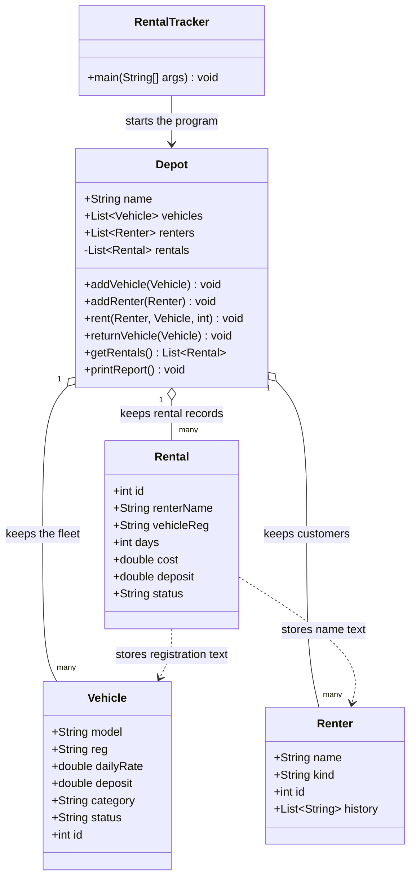
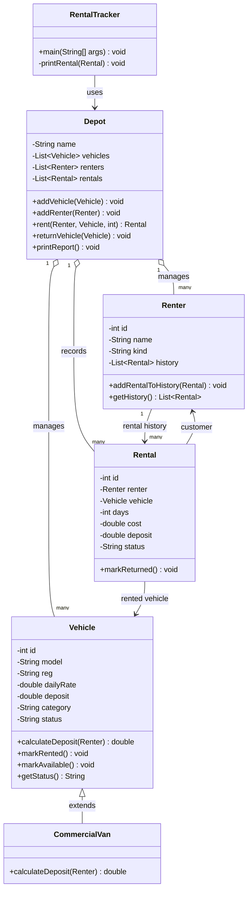

# UML Class Diagrams

Mermaid class diagrams for the original code and updated/rebuild code.

## 1. Inherited design — original program

### What is difficult about the original design?

Most of the work is placed inside `Depot`. Many fields are public, and `Rental` only stores a vehicle registration and renter name as text. The program also does not stop someone from renting a vehicle that is already out.

## 2. New design - Updated program

### What each class does

| Class | Responsibility |
|---|---|
| `RentalTracker` | Starts the program and shows the example day. |
| `Depot` | Adds vehicles and renters, handles renting and returning, and prints the report. |
| `Vehicle` | Stores common vehicle details and the normal car deposit rule. |
| `CommercialVan` | Represents a van and provides a separate place for its future deposit rule. |
| `Renter` | Stores customer details and their rental history. |
| `Rental` | Stores the details and status of one rental. |

## 3. Design notes and conclusion

Please refer to the `NOTES.md` in the dir for the notes in the update

- The main fix is in `Depot.rent()`: it checks that the vehicle is available before saving a rental. It also checks that the renter and vehicle have been added to the depot and that the number of days is positive.

+ The extra feature is customer rental history. `Renter` stores the actual `Rental` objects, so returned rentals remain available for a later customer enquiry.

#### Note for Commercial Vans

 * The business has not supplied the commercial-van deposit rules. So that will be updates when the rule comes up.

**Conclusion:** the rebuilt prevents the main booking mistake in the original. Each class has a clear job, and the commercial-van deposit decision has a clear place to be added once the business provides the details.
